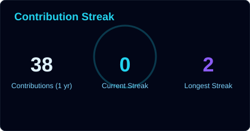
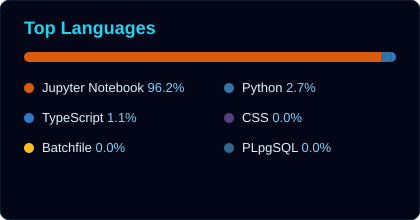
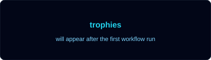
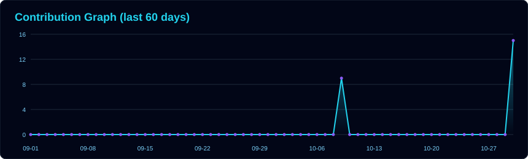

<!-- AI Futuristic GitHub Profile README for Sanidhya Shekhar -->

  

  

  
  
  

---

###  About Me

I am **Sanidhya Shekhar**, an **Aspiring Data Scientist** currently pursuing an **MS in Computer Science specializing in Machine Learning and AI Engineering**.

I work across **Data Science, Machine Learning, Generative AI, LLMs, RAG, MLOps, and AI-powered application development**. My focus is on engineering **scalable, intelligent, and production-ready AI systems** using modern tools like **Python, FastAPI, LangChain, LangGraph, Docker, Kubernetes, MLflow, Airflow, Neo4j, PostgreSQL, and Redis**.

- 🔭 Currently building AI-powered memory systems and MLOps pipelines
- 🌱 Learning advanced **Machine Learning, AI Engineering, LLMOps, and MLOps**
- 🧠 Interested in **Generative AI, RAG, MCP, Recommendation Systems, Computer Vision, and Scalable AI Infrastructure**
- 💬 Ask me about **Python, ML, Data Science, LLMs, RAG, MLOps, and AI projects**
- 📫 Reach me at **sanidhyashekhar1996@gmail.com**
- ⚡ Fun fact: I enjoy turning messy data into intelligent systems

---

## 🚀 Tech Stack

### 👨‍💻 Programming & Data

  
  
  
  
  

### 🤖 Machine Learning & Data Science

  
  
  
  
  
  
  

### 🧠 Generative AI & LLM Engineering

  
  
  
  
  
  
  

### ⚙️ MLOps, DevOps & Cloud

  
  
  
  
  
  
  
  
  
  

### 🌐 Full Stack & Databases

  
  
  
  
  
  
  
  

---

## 🧩 Featured Projects

<table>
  <tr>
    <td width="50%">
      <h3>🎧 Spotify Personalized AI Memory System</h3>
      An AI-powered personalized memory system using <b>LLMs, RAG, MCP, FastAPI, Next.js, Neo4j, PostgreSQL, Redis, Docker, and Kubernetes</b>.
        
      <b>Highlights:</b>
      <ul>
        <li>Built a privacy-aware AI memory framework</li>
        <li>Designed REST endpoints and MCP tools for secure model communication</li>
        <li>Used Neo4j temporal knowledge graphs and vector embeddings</li>
        <li>Targeted low-latency contextual memory retrieval under 250ms p95</li>
      </ul>
      <b>Tech:</b> <code>Python</code> <code>FastAPI</code> <code>Next.js</code> <code>React</code> <code>Tailwind CSS</code> <code>Gemini</code> <code>MCP</code> <code>Neo4j</code> <code>PostgreSQL</code> <code>Redis</code> <code>Docker</code>
    </td>
    <td width="50%">
      <h3>✈️ Voyage Analytics: Integrating MLOps in Travel</h3>
      A production-grade MLOps pipeline for travel analytics using flight and hotel interaction data.
        
      <b>Highlights:</b>
      <ul>
        <li>Processed <b>271,888 flight records</b> and <b>40,552 hotel interactions</b></li>
        <li>Compared 7 regression algorithms using 5-fold cross-validation</li>
        <li>Achieved <b>0.9949 R²</b> and <b>25.84 RMSE</b> with Random Forest</li>
        <li>Built Airflow DAGs, Jenkins CI/CD pipelines, and MLflow tracking</li>
      </ul>
      <b>Tech:</b> <code>Python</code> <code>Flask</code> <code>Docker</code> <code>Kubernetes</code> <code>Airflow</code> <code>Jenkins</code> <code>MLflow</code> <code>Scikit-Learn</code>
    </td>
  </tr>
  <tr>
    <td width="50%">
      <h3>🎬 Netflix Movies and TV Shows Clustering</h3>
      An unsupervised ML project for clustering Netflix movies and TV shows using NLP and dimensionality reduction.
        
      <b>Highlights:</b>
      <ul>
        <li>Processed <b>7,787 Netflix catalog entries</b></li>
        <li>Generated <b>20,000 text features</b> using TF-IDF</li>
        <li>Applied PCA for dimensionality reduction</li>
        <li>Used K-Means and Agglomerative Clustering</li>
        <li>Achieved <b>0.6514 Silhouette Score</b></li>
      </ul>
      <b>Tech:</b> <code>Python</code> <code>Pandas</code> <code>Scikit-Learn</code> <code>NLTK</code> <code>TF-IDF</code> <code>PCA</code> <code>Matplotlib</code> <code>Seaborn</code>
    </td>
    <td width="50%">
      <h3>🖼️ Computer Vision Face Restoration Pipeline</h3>
      A computer vision pipeline for restoring low-quality, historical, and corrupted portraits.
        
      <b>Highlights:</b>
      <ul>
        <li>Used <b>PyTorch, OpenCV, and GFPGAN</b></li>
        <li>Automated blind face restoration workflows</li>
        <li>Improved degraded portrait quality</li>
        <li>Optimized preprocessing and inference scripts</li>
      </ul>
      <b>Tech:</b> <code>Python</code> <code>PyTorch</code> <code>OpenCV</code> <code>GFPGAN</code> <code>Computer Vision</code>
    </td>
  </tr>
</table>

---

## 💼 Experience

### 🏢 Postulate Info Tech Private Limited — Internship
**February 2025 – March 2025**
- Engineered a computer vision pipeline using **PyTorch, OpenCV, and GFPGAN**
- Restored low-quality, historical, and corrupted portraits
- Optimized preprocessing and inference scripts for blind face restoration

### 🎓 AlmaBetter Trainee
**January 2024**
- Built predictive models using **Random Forest, Lasso, and Ridge Regression**
- Forecasted airline referrals and bike demand
- Achieved **95.32% accuracy** and **0.7037 R² score**
- Performed EDA and clustering on Netflix and Play Store datasets

---

## 🎓 Education

- 🎓 **MS in Computer Science: Machine Learning & AI Engineering** — **AlmaBetter** | 2024 – Present
- 🎓 **Bachelor of Computer Applications** — **Maharaja Agrasen Himalayan Garhwal University** | 2022

---

## 🏆 Certifications & Achievements

- 🧠 **Advanced Certification in Full Stack Data Science & AI** — E&ICT IIT Guwahati
- 📊 **Tata Group Data Visualisation Job Simulation** — Forage
- 💻 **Full Stack Data Science Program** — AlmaBetter
- ⭐ **HackerRank Python 5-Star Gold Badge**
- ⭐ **HackerRank SQL 4-Star Gold Badge**

---

## 📊 GitHub Analytics

  
  

  

---

## 🏆 GitHub Trophies

  

---

## 📈 Contribution Graph

  

---

## 🐍 Contribution Snake

  

---

## 🌐 Connect With Me

  
  
  

  

